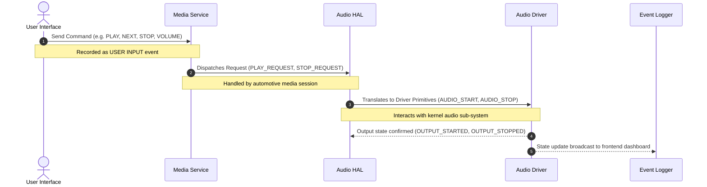

# IVI Message Flow Simulator (`ivisim`)

[](https://www.python.org/downloads/)
[](https://flask.palletsprojects.com/)
[](LICENSE)
[]()

A lightweight, software-only simulator demonstrating **In-Vehicle Infotainment (IVI)** audio architecture and message flows. It simulates the sequential event propagation through four core automotive software layers:

$$\text{User Input} \longrightarrow \text{Media Service} \longrightarrow \text{Audio HAL} \longrightarrow \text{Audio Driver}$$

Designed as a clean, dependency-free reference implementation of automotive audio control flows without requiring physical hardware, CAN buses, or a full Android Automotive OS (AAOS) environment.

---

## Architecture Overview

In modern connected vehicles, user actions on the IVI display do not directly communicate with audio hardware. Instead, they pass through abstraction layers for routing, safety arbitration, and hardware decoupling:



### Layer Responsibilities

| Layer | Component | Function in IVI Architecture |
| :--- | :--- | :--- |
| **01** | **User Input** | Captures driver/passenger interactions (touch controls, steering wheel keys, volume dials). |
| **02** | **Media Service** | High-level media session management, playlist/track indexing, playback arbitration, and policy handling. |
| **03** | **Audio HAL** | Hardware Abstraction Layer that standardizes audio streams and translates intents into hardware commands. |
| **04** | **Audio Driver** | Kernel/firmware-level interface controlling physical amplifier gain, DACs, and speaker output lines. |

---

## Features

- **Interactive Transport Controls**: Seamless `PLAY`, `PAUSE`, `NEXT TRACK`, and `STOP` command execution.
- **Continuous Volume Regulation**: Linear `0%` to `100%` volume slider with instant HAL attenuation updates.
- **Real-time Telemetry Dashboard**:
  - **Media State**: `PLAYING` vs `STOPPED`
  - **Active Track**: Track metadata indexing (`Demo Track 01`, `02`, `03`)
  - **Audio HAL State**: `ACTIVE` vs `IDLE`
  - **Audio Driver State**: `OUTPUT_ACTIVE` vs `OUTPUT_IDLE`
- **Chronological Message Log**: Rolling event log tracking timestamps, layer provenance, and message payloads across all actions.
- **Modernized Dark Glow Interface**:
  - Inverted high-contrast dark theme (`#0b0b0b` background with elevated `#141414` cards).
  - Ambient white aura / luminous glow (`box-shadow`) on cards, buttons, and status tiles.
  - Consistent rounded geometry (`border-radius`) across all interactive elements.
  - Strict pixel-perfect levelling: Flow cards are height-matched, and the Message Log container is dynamically levelled to match the bottom edge of the volume dragger.
- **Zero Heavy Dependencies**: Pure Python backend (Flask) with vanilla HTML5/CSS3/JavaScript frontend. No database or external services required.

---

## Project Structure

```
IVI_Message_Flow_Simulator/
├── backend/
│   ├── app.py             # Flask REST API & static asset delivery
│   └── simulator.py       # Core IVI state machine and event logger
├── frontend/
│   ├── index.html         # Responsive IVI dashboard layout
│   ├── style.css          # Inverted dark design system, aura glows & grid levelling
│   └── script.js          # Telemetry polling, API dispatch & dynamic height sync
├── .gitignore             # Python & environment exclusions
└── README.md              # Project documentation
```

---

## Getting Started

### Prerequisites

- **Python 3.9+**
- **pip** package manager

### 1. Clone the Repository

```bash
git clone https://github.com/mehulb-01/ivisim.git
cd ivisim
```

### 2. Install Dependencies

Navigate to the `backend` folder and install Flask and Flask-CORS:

```bash
cd backend
pip install flask flask-cors
```

### 3. Run the Simulator

Start the Flask server from the `backend` directory:

```bash
python app.py
```

The application will launch on:
```
http://127.0.0.1:5000
```

Open this address in any modern web browser to access the simulator.

---

## REST API Reference

The backend exposes three lightweight endpoints for integration and automated testing:

### 1. Get System State
- **Endpoint**: `GET /api/state`
- **Description**: Returns the current playback status, volume, active track, layer states, and recent log history.
- **Response**:
  ```json
  {
    "playing": true,
    "volume": 70,
    "track": "Demo Track 01",
    "audio_hal": "ACTIVE",
    "driver": "OUTPUT_ACTIVE",
    "logs": [
      {
        "time": "22:54:58",
        "component": "AUDIO DRIVER",
        "message": "OUTPUT_STARTED"
      },
      {
        "time": "22:54:58",
        "component": "AUDIO HAL",
        "message": "AUDIO_START"
      }
    ]
  }
  ```

### 2. Dispatch Control Action
- **Endpoint**: `POST /api/action`
- **Payload**:
  ```json
  {
    "command": "play"
  }
  ```
- **Allowed Commands**: `"play"`, `"pause"`, `"next"`, `"stop"`
- **Response**: Returns the updated system state.

### 3. Set Audio Volume
- **Endpoint**: `POST /api/volume`
- **Payload**:
  ```json
  {
    "volume": 85
  }
  ```
- **Range**: Integer between `0` and `100`.
- **Response**: Returns the updated system state.

---

## Suggested Demonstration Steps

1. Launch the application and observe the **SYSTEM ONLINE** status and initial idle states.
2. Click **PLAY**:
   - Observe `USER INPUT: PLAY` in the message log.
   - Watch the command propagate to `MEDIA SERVICE` (`PLAY_REQUEST`), `AUDIO HAL` (`AUDIO_START`), and `AUDIO DRIVER` (`OUTPUT_STARTED`).
   - Notice the telemetry cards transition to **PLAYING**, **ACTIVE**, and **OUTPUT_ACTIVE**.
3. Click **NEXT**:
   - The media service increments the track index to `Demo Track 02` and issues a `NEXT_TRACK_REQUEST`.
4. Adjust the **VOLUME** dragger:
   - Real-time `SET_VOLUME` events propagate down to the HAL layer and update the percentage readouts.
5. Click **STOP**:
   - Telemetry resets to `STOPPED`, `IDLE`, and `OUTPUT_IDLE`.

---

## License

This project is licensed under the [MIT License](LICENSE).
